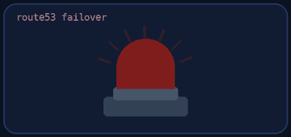
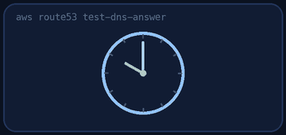
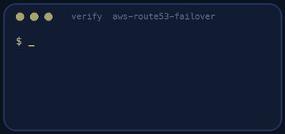
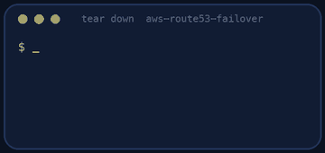

<p align="center"></p>

| | |
|-|-|
| **Time** | 75-90 min |
| **Cost** | a few cents (two small servers, a hosted zone deleted the same day, two health checks) |
| **You need** | An AWS administrator user (the IAM lab), the AWS CLI v2 configured for it, Python 3 and a terminal, curl |

## How this lab works

1. **Fork** this repository to your own GitHub account (button at the top right).
2. Clone **your fork** in your Ubuntu environment (WSL on Windows, your OrbStack machine on Mac).
3. Read the lab below (the same text is in [`LAB.md`](LAB.md)) and follow the mission.
4. Answer the questions in [`SUBMISSION.md`](SUBMISSION.md). Where a question asks for output, paste it in a code block. No screenshots needed.
5. Commit and push. Open the **Actions** tab of your fork (click *I understand my workflows, go ahead and enable them* the first time). The **Lab check** shows what is still missing.
6. When the check is green, **submit the URL of your fork** in the course platform.

> [!NOTE]
> The check only looks at your answers and any files the lab asks you to commit. Your instructor reads your work and may ask you to explain any line.

<p align="center"></p>

## 🎬 The situation

<p align="center"></p>

The Clippy short links all use one name, `app.<your domain>`. That name points to one server. At 03:12 on a Sunday the server's disk filled up and every link in every printed brochure returned an error until somebody woke up at 07:40.

You will make the name smart: Route 53 **watches** the primary server with a health check, and when the check fails, it starts answering with the **standby** server's address instead. Nobody has to wake up. Then you will test it the honest way, by stopping the primary on purpose and asking Route 53 itself what it answers.

> [!IMPORTANT]
> **Your mission**
> - Create a public hosted zone and two failover records (primary and secondary) with a short TTL
> - Create an HTTP health check on the primary's `/healthz`, fast enough to matter
> - Stop the primary and measure how long the failover takes, then bring it back
> - Compute the real worst case from your own numbers
> - Tear it all down and prove it

**Time:** 75-90 min | **Cost:** a few cents (two small servers, a hosted zone deleted the same day, two health checks) | **You need:** an AWS administrator user, the AWS CLI v2 configured for it, Python 3, curl and a terminal. You do **not** need to own a domain.

<p align="center"></p>

## Part 0 - Set the scene

1. **Fork** this repository, clone it, and launch the two servers:

```bash
./setup.sh
```

You get a **primary** and a **secondary** Clippy server, each with an **Elastic IP** (so a stop and start does not change its address), and the exact name your hosted zone must have. The `version` field of `http://<ip>/healthz` says which server answered. Wait two minutes for Clippy to install.

> [!NOTE]
> **Think** Why does the standby run all the time, costing money, instead of being started when the primary fails? What would a cold standby cost you in failover time?

<p align="center"></p>

## Part 1 - The zone and the health check

<p align="center"></p>

1. Create a **public hosted zone** with the name `setup.sh` printed (`lab-<account id>.clippylab.net`). You do not own `clippylab.net` and you do not need to: the zone answers questions asked directly to Route 53, which is all this lab does. Tag the zone `lab = aws-route53-failover`.

```bash
aws route53 create-hosted-zone --name lab-<account>.clippylab.net --caller-reference lab-$(date +%s)
```

2. Create a **health check** on the primary's Elastic IP: type HTTP, port 80, path `/healthz`, **request interval 10 seconds**, **failure threshold 2**. Tag it `lab = aws-route53-failover` (use `aws route53 change-tags-for-resource --resource-type healthcheck`). Wait until `aws route53 get-health-check-status` says `Success`.

> [!NOTE]
> **Think** Route 53 checks from many places around the world, not from one. Why is that better than one checker, and what does it mean for the security group of the primary?

<p align="center"></p>

## Part 2 - The two records

Create two `A` records for `app.<zone>` in one change batch (a JSON file):

| SetIdentifier | Failover | Value | TTL | Health check |
|---------------|----------|-------|-----|--------------|
| `primary` | `PRIMARY` | the primary's Elastic IP | **30** | yours |
| `secondary` | `SECONDARY` | the secondary's Elastic IP | **30** | none |

Ask Route 53 what it answers, as a resolver would:

```bash
aws route53 test-dns-answer --hosted-zone-id <zone id> --record-name app.<zone> --record-type A
```

The answer is the primary's address.

> [!NOTE]
> **Think** The record has a TTL of 30 seconds. A resolver that already looked the name up keeps its answer for that long. Which two numbers add up to the worst case a customer can experience? Write the formula and compute it for your settings.

<p align="center"></p>

## Part 3 - Pull the plug

In one terminal, ask Route 53 every five seconds what it answers:

```bash
while true; do date +%T; aws route53 test-dns-answer --hosted-zone-id <zone id> --record-name app.<zone> --record-type A --query 'RecordData[0]' --output text; sleep 5; done
```

In another, **stop the primary server** (console or `aws ec2 stop-instances`). Watch the first terminal. Write down how many seconds passed until the answer changed to the secondary's address. Then **start the primary again** and watch the answer return.

Look at the health check status while it fails and while it recovers:

```bash
aws route53 get-health-check-status --health-check-id <id> --query 'HealthCheckObservations[].[Region,StatusReport.Status]' --output text
```

> [!NOTE]
> **Think** Which of the three DNS timers matters most to your customers: the check interval, the failure threshold or the TTL? What would you change to halve the failover time, and what would it cost (money, false alarms)?

<p align="center"></p>

## Part 4 - Prove it

<p align="center"></p>

```bash
./verify.sh
```

It reads your zone, both records, the health check settings and **asks Route 53 what it answers right now**, and with the health check's CloudWatch history it confirms that the primary really went from healthy to unhealthy (CloudWatch can take three to five minutes to show it). Fix what is red and run it again until it ends with **ALL CHECKS PASSED**. Leave the primary running when you run it.

> [!TIP]
> **Stuck?** The health check never turns healthy: the security group on the servers must allow port 80 from anywhere (Route 53 checkers are many addresses) and Clippy needs two minutes. `test-dns-answer` answers the secondary while the primary runs: the health check is not `Success` yet, or it checks the wrong IP. The "went unhealthy" check is red: you did not stop the primary after the check was healthy, or CloudWatch has not caught up.

<p align="center"></p>

## Level up (optional)

- Replace the standby server with a static page in S3 behind CloudFront. What is the trade-off?
- Add a **calculated** or **CloudWatch alarm** health check so that failover also happens when the database is down, not only when `/healthz` answers.
- Compare **failover**, **weighted** and **latency** routing for: (a) a blue/green cutover, (b) users in Europe and Asia, (c) a standby.
- Add health-check notifications to an SNS topic that e-mails you.

<!-- teardown:start (generated by labs.py, do not edit) -->
## Tear down (mandatory)

<p align="center"></p>

Resources left behind cost money, keep doors open and pollute the next lab. Removing what you created is part of the job, so it is part of the submission: **you must prove it is gone**.

Do this **last**, after you have pasted your `verify` output into `SUBMISSION.md` (once you tear down, the lab can no longer be verified).

1. Run `./teardown.sh`. It deletes the records, the health checks, the hosted zone and the servers. Then run `./verify-teardown.sh`.

Then run the proof:

```bash
./verify-teardown.sh
```

It prints a list of checks and must end with **TEARDOWN VERIFIED**. If it reports leftovers, remove them and run it again. Paste the full output in your submission.
<!-- teardown:end -->

<!-- submission:start (generated by labs.py, do not edit) -->
## 📬 Submission

Answer the questions in `SUBMISSION.md` in **your fork** (paste output in code blocks where asked), push, then submit the **URL of your fork**.

**Files to commit**

- `notes.md` with your commands and what you saw (optional)

**Questions to answer**

1. Paste the two failover records (primary and secondary) and the health check settings. What are the interval, the failure threshold and so the longest time before a failover?
2. Stop the primary and paste the answers of `aws route53 test-dns-answer` before and after. How long did the change take and what decided it?
3. What does the record TTL do to the clients that already looked the name up? Which two numbers add up to the real worst case?
4. Why can the health check not tell the difference between "the server is down" and "the health check endpoint is broken"? What did you serve at `/healthz`?
5. Failover routing, weighted routing and latency routing: pick the right one for (a) a blue/green cutover, (b) users in Europe and Asia, (c) a standby.
6. Paste the output of `./verify.sh`. It must end with **ALL CHECKS PASSED**.
7. **Tear down.** Paste the output of `./verify-teardown.sh`. It must end with **TEARDOWN VERIFIED**.
<!-- submission:end -->
